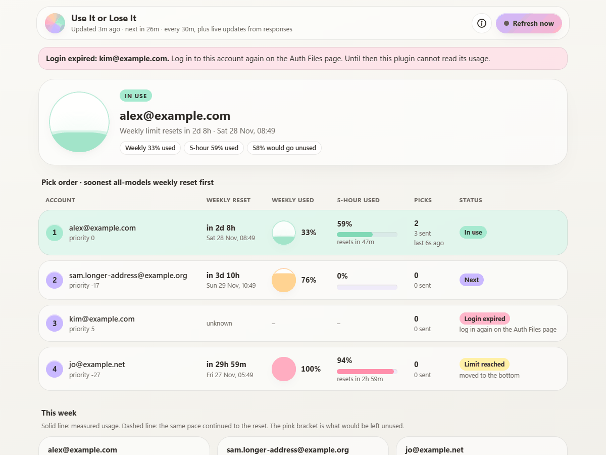
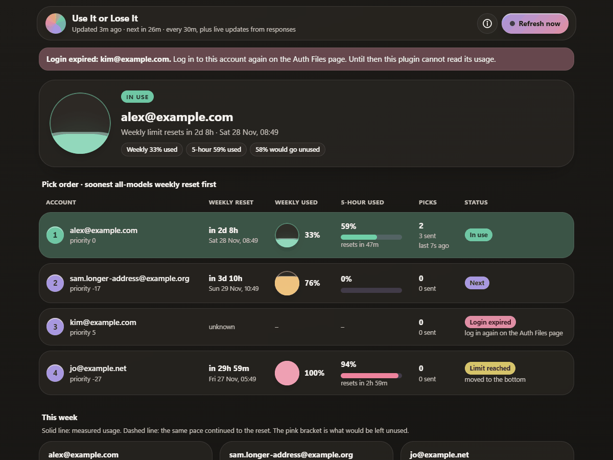

# Use It or Lose It

A [CLIProxyAPI](https://github.com/router-for-me/CLIProxyAPI) scheduler plugin for Claude accounts. It sends each request to the account whose weekly limit resets soonest, so quota that is about to expire is used before it's gone.

## Why

Every Claude Pro or Max account has a weekly limit that resets at its own time. Whatever an account hasn't used by then is lost. CLIProxyAPI's built-in routing (round-robin, fill-first or priorities) doesn't know about reset times. It can keep sending requests to an account with days left while another one is about to reset with quota unused.

A fixed priority doesn't solve this, because the right order changes every time an account resets. Say account B resets first, so you give it the top priority. B runs out and requests move to A, which is correct. Then B resets. It now has a full week ahead and should be used last. But it still has the top priority, so requests go straight back to it, and A's remaining quota expires.

This plugin works out the order again for every request, from each account's real reset time and usage.

## How it picks

CLIProxyAPI gives the plugin the accounts it considers usable for the request: enabled, supporting the model, and not cooling down after a rate limit. Accounts from every priority level are included. The plugin sorts them by these rules, in this order:

1. **Full accounts last.** An account is full when its 5-hour or weekly limit is at 100% and hasn't reset yet. You can turn this rule off.
2. **Accounts with usage data before accounts without.**
3. **Soonest weekly reset first.**
4. **Higher CLIProxyAPI priority first.** Priority only breaks ties.
5. **Account ID**, as the last tie-breaker.

It then sends the request to the first account. When an account resets, its next reset is a week away, so it moves to the back by itself.

The plugin leaves the choice to CLIProxyAPI's normal routing when:

- any account offered for the request isn't a Claude account (for example, a request that could also go to another provider), or
- the first account after sorting has no usage data. This happens right after startup, and when every account with data is full while some account without data is still offered.

While the plugin makes the choice, your `routing.strategy` setting and account priorities don't decide the order. If every account is full, the plugin still picks one: the full account whose weekly limit resets soonest.

## Where the usage data comes from

- **Timed checks.** Every 30 minutes by default, the plugin asks Anthropic's usage endpoint for each Claude account's 5-hour and weekly usage. It uses the login CLIProxyAPI already holds for that account. It also checks about 2 minutes after a known reset time passes, because the order changes then.
- **Live updates.** Every Claude response carries `anthropic-ratelimit-unified-*` headers with the 5-hour and weekly usage. The plugin reads them from each finished request, so the numbers stay current between checks without extra calls.
- **Never per request.** Picking an account only reads cached data. It never waits on the network.

If a check shows that an account CLIProxyAPI is still holding in cooldown has room again, for example after an early reset, the plugin clears that cooldown so the account can be used right away. It does this at most once every 30 minutes per account.

## Install

You need CLIProxyAPI v8.0.29 or newer, with at least one Claude account logged in.

### From the plugin store (recommended)

1. Add this plugin's registry to `config.yaml`. The official registry stays included.

   ```yaml
   plugins:
     enabled: true
     store-sources:
       - "https://akhilasuraj.github.io/claude-use-it-or-lose-it/registry.json"
   ```

2. In the management panel, open the plugin store, find **Use It or Lose It** (marked third-party) and click **Install**.

The store downloads the build for your system and checks it against the release's `checksums.txt`. When a new version is released, the store shows an **Update** button. Updates aren't installed automatically. Each version is saved under its own file name, such as `claude-use-it-or-lose-it-v1.1.0.dll`, so CLIProxyAPI switches to the new version without a restart.

If you installed the plugin by hand before, delete that copy from your plugins folder, so only one copy is left.

### By hand

1. Download `claude-use-it-or-lose-it_<version>_<os>_<arch>.zip` for your platform from [Releases](https://github.com/akhilasuraj/claude-use-it-or-lose-it/releases). You can check it against `checksums.txt`.
2. Unzip it. It contains one file: `claude-use-it-or-lose-it.dll`, `.so` or `.dylib`.
3. Put that file in your plugins folder (`plugins.dir`, `plugins` by default).
4. Turn on plugins and this plugin in `config.yaml`, as shown below.

To update a manual install, replace the file and restart CLIProxyAPI. Until the restart, it keeps running the copy it already loaded.

### Settings in config.yaml

```yaml
plugins:
  enabled: true
  configs:
    claude-use-it-or-lose-it:
      enabled: true
      "Check usage every (minutes)": 30
      "Move full accounts to the bottom": true
      "Watch only, do not change routing": false
      "Folder for usage history": ""
```

Every setting is optional. You can also change them on the Plugins page of the management panel. The setting names are long because the panel shows them as labels.

## Settings

| Setting | Values | Default | What it does |
|---|---|---|---|
| `Check usage every (minutes)` | integer, at least 5 | `30` | How often usage is checked with Anthropic. Lower values aren't needed in normal use, because live updates fill the gaps. |
| `Move full accounts to the bottom` | `true`, `false` | `true` | Accounts at 100% of their 5-hour or weekly limit are tried last. |
| `Watch only, do not change routing` | `true`, `false` | `false` | The plugin works out its pick and shows it on the status page, but requests keep using the normal routing. |
| `Folder for usage history` | path | empty | Where `history.json` is kept. If empty, a `claude-use-it-or-lose-it` folder in your user config folder is used (`%APPDATA%` on Windows, `~/Library/Application Support` on macOS, `~/.config` on Linux). In Docker, point it at a mounted volume. |

The weekly limit used is the one that applies across all models. Claude plans no longer have separate Opus or Sonnet weekly limits. The Fable limit on Max and Ultra plans is a share of the all-models weekly limit, not extra quota, and the plugin doesn't track it separately. Versions before 1.1.0 had a `Weekly limit to order by` setting. If your `config.yaml` still has it, it's ignored.

Older snake_case keys (`refresh_interval_minutes`, `deprioritize_exhausted`) are still accepted.

## Status page

In the management panel, choose **Use It or Lose It** from the plugin menu. The page follows the panel's light and dark themes, works at phone width, and updates in place every minute. It shows:

- the account in use now, or the account it would pick in watch-only mode;
- the pick order, with each account's weekly reset, weekly and 5-hour usage, and its state: *In use*, *Next*, *Standby*, *Limit reached*, *No reset data*, *Renewing login*, *Check failed* or *Login expired*;
- for each account, how many requests the plugin picked it for and how many were actually sent with it (both counts start at zero when CLIProxyAPI starts);
- a chart of this week's usage for each account, with the current pace drawn on to the reset. It shows when the account would run out at that pace, or how much of its weekly limit would go unused. The pace needs at least 2 hours of readings in the current week;
- a **Refresh now** button, which checks usage at most once a minute.




## Expired logins

If an account's usage can't be read, the plugin keeps that account's last readings, so one failed check doesn't reorder anything, and tries again after 2 minutes. An account is shown as **Login expired** only when:

- its credential has no access token,
- Anthropic rejects the token (HTTP 401) on two checks in a row,
- the token stays expired through 8 checks in a row (about 15 minutes), or
- CLIProxyAPI itself marks the credential as failing with a login or refresh error.

Right after the computer wakes from sleep, an account can show **Renewing login** for a short while. CLIProxyAPI renews tokens on its own schedule, and the plugin waits for that instead of using an expired token. As soon as a request is served with the account, any warning is cleared.

To fix a real expired login, log in to the account again on the Auth Files page.

## Good to know

- **Don't run it alongside another scheduler plugin.** CLIProxyAPI asks scheduler plugins in turn, highest `priority` in `plugins.configs` first, and the first one that makes a choice wins. Pick one.
- **Claude API keys.** If you also have Claude API-key entries, the plugin has no usage data for them. It ranks them after the logged-in accounts, so they're only used through the normal routing, when no logged-in account with data is available.
- **The usage endpoint isn't a public API.** Anthropic doesn't document it, and if Anthropic changes it, the timed checks fail. Live updates from response headers keep working, and when there's no data, routing falls back to normal.
- **Counts are in memory.** Pick and sent counts reset when CLIProxyAPI restarts. The usage history in `history.json` is kept.

## Permissions and privacy

The plugin uses these CLIProxyAPI host calls:

| Call | Why |
|---|---|
| `host.auth.list` | Finds the Claude accounts and reads their priority, status and e-mail address. |
| `host.auth.get` | Reads a Claude credential. Only the access token and its expiry time are used, and only to call Anthropic's usage endpoint. |
| Usage records | Reads the provider, account and response headers of each finished request, to pick up the rate-limit headers. |
| `host.routing.reset_cooldown` | Clears the cooldown on an account that has room again. |
| `host.log` | Writes its own lines to the CLIProxyAPI log. |

**Network:** the only outside request is `GET https://api.anthropic.com/api/oauth/usage`, sent with each account's own token. There's no telemetry, and nothing is sent anywhere else.

**Disk:** it writes one file, `history.json`. For each account it stores the e-mail address, usage percentages, reset times and timestamps, with at most one reading per account every 10 minutes. Readings older than 15 days are removed.

## Compatibility

- CLIProxyAPI v8.0.29 or newer. The plugin is built against the v8.0.29 SDK.
- Claude Pro and Max accounts logged in through OAuth.
- Windows, Linux and macOS, on amd64 and arm64.

## Build from source

You need Go (see `go.mod`) and a C compiler, because the plugin is a cgo shared library.

```sh
go test ./...
CGO_ENABLED=1 go build -buildmode=c-shared -trimpath -ldflags "-s -w" -o build/claude-use-it-or-lose-it.so .
```

Use `.dll` on Windows and `.dylib` on macOS. Copy only the library into your plugins folder. You don't need the generated `.h` file.

## Uninstall

1. If you installed from the store, click **Delete** on the Plugins page. Otherwise, delete the library from your plugins folder and remove the `claude-use-it-or-lose-it` block from `plugins.configs` (or set `enabled: false`).
2. Optional: delete the history folder.

CLIProxyAPI goes back to its normal routing.

## FAQ

**Does it slow down requests?**
No. Picking only reads cached data. Usage checks run in the background.

**Can I try it without changing my routing?**
Yes. Turn on `Watch only, do not change routing` and compare its picks on the status page with what was actually sent.

**I use Claude together with other providers. What happens?**
Requests that can only go to Claude accounts are routed by the plugin. A request whose accounts include another provider is left to the normal routing.

**Why does the same account get every request?**
Because it resets soonest. The plugin keeps using it until it's full or resets, then moves on. Staying on one account also keeps Claude's prompt cache useful within a conversation.

## License

[MIT](LICENSE) © 2026 Akhila Abesinghe
